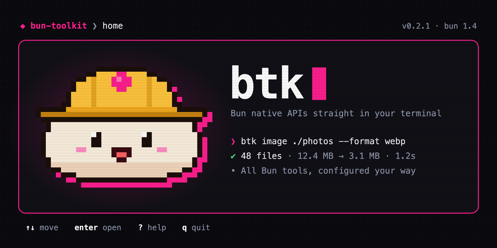

# bun-toolkit

<p align="center">
  
</p>

<p align="center">
  <strong>Bun native APIs straight in your terminal.</strong><br>
  One CLI, one config, one output style, and an interactive dashboard for every tool.
</p>

<p align="center">
  <a href="https://github.com/davidpn11/bun-toolkit/releases/latest"></a>
  <a href="https://github.com/davidpn11/bun-toolkit/actions/workflows/test.yml"></a>
  <a href="LICENSE"></a>
</p>

`btk` puts the APIs built into Bun, such as `Bun.Image`, `Bun.CryptoHasher`, `Bun.YAML` and `Bun.password`, behind one command. It ships as a single binary, so it needs neither Bun nor Node on the machine that runs it.

- **Five tools:** `image`, `hash`, `convert`, `password`, and `compress` with `decompress`.
- **One config** in TypeScript or JSON, with global and per-project tiers and `BTK_*` environment variables.
- **Three output modes:** colors in a terminal, plain text in CI, and one JSON document with `--json`.
- **A dashboard for every tool:** `btk ui` or `btk <tool> --ui`.

## Install

### Homebrew

This repository is the tap. Add it once, then install:

```bash
brew tap davidpn11/bun-toolkit https://github.com/davidpn11/bun-toolkit
brew install davidpn11/bun-toolkit/bun-toolkit
```

Homebrew 5.1 and later refuse to load a formula from a tap you haven't trusted. If yours does, run the `brew trust` command it prints, then install again. `brew upgrade bun-toolkit` picks up new releases.

Pre-releases are a separate formula. Only one of the two can be installed at a time, because both install `btk`:

```bash
brew install davidpn11/bun-toolkit/bun-toolkit-beta
```

### Download a binary

Every [release](https://github.com/davidpn11/bun-toolkit/releases) has binaries for macOS, Linux and Windows, plus a `SHA256SUMS` file:

```bash
curl -fsSLO https://github.com/davidpn11/bun-toolkit/releases/latest/download/btk-darwin-arm64
curl -fsSLO https://github.com/davidpn11/bun-toolkit/releases/latest/download/SHA256SUMS
grep btk-darwin-arm64 SHA256SUMS | shasum -a 256 -c
chmod +x btk-darwin-arm64 && sudo mv btk-darwin-arm64 /usr/local/bin/btk
```

Replace `darwin-arm64` with `darwin-x64`, `linux-x64`, `linux-arm64` or `windows-x64.exe`.

### From source

Requires [Bun](https://bun.sh) 1.4 or later.

```bash
git clone https://github.com/davidpn11/bun-toolkit && cd bun-toolkit
bun install
bun link            # puts btk and bun-toolkit on your PATH
```

## Quick start

```bash
btk info                    # versions, platform, output mode, config status
btk init                    # create ./btk.config.ts in this project
btk image hero.png          # hero.webp next to it
btk hash package.json       # sha256, in sha256sum format
btk convert config.yaml     # JSON on stdout
btk ui                      # the dashboard
```

Every command takes `--help`, `--json`, `--verbose`, `--no-color` and `--config <path>`.

## Tools

### btk image

Convert, resize and inspect images with `Bun.Image`, without sharp or ImageMagick. [Full docs](docs/tools/image.md)

```bash
btk image ./assets -r --format avif -q 60           # a whole tree, as AVIF
btk image ./photos --preset web --out-dir dist/img  # 1920px wide, q75, into dist/img
btk image info hero.png --placeholder               # dimensions, size and a ThumbHash
```

### btk hash

Hash and verify files with 31 algorithms. The output is `sha256sum`-compatible, and SRI and HMAC are supported. [Full docs](docs/tools/hash.md)

```bash
btk hash ./dist -r > SHA256SUMS            # a checksums file
btk hash check SHA256SUMS                  # exits 1 if a file changed
printf hello | btk hash verify - 3610a686  # check standard input against a known hash
```

### btk convert

Convert between JSON, YAML, TOML, XML, JSON5, JSONC and JSONL. [Full docs](docs/tools/convert.md)

```bash
btk convert docker-compose.yml | jq '.services | keys'
btk convert tsconfig.json --to yaml -o tsconfig.yaml
cat logs.jsonl | btk convert --from jsonl
```

### btk password

Hash, verify and inspect argon2 and bcrypt password hashes. [Full docs](docs/tools/password.md)

```bash
btk password hash                          # type it twice at a hidden prompt
echo "$PASSWORD" | btk password verify "$HASH"
btk password inspect "$HASH"               # algorithm, cost, and whether it needs a rehash
```

### btk compress and btk decompress

gzip, zstd, brotli and deflate, plus folder archives. [Full docs](docs/tools/compress.md)

```bash
btk compress ./dist --each --gzip --brotli  # precompress static files
btk compress ./site --zstd                  # site.tar.zst
btk decompress site.tar.zst                 # site/
```

## Configuration

btk reads a global config in `~/.bun-toolkit/` and a project config found by walking up from the current directory. Both can be TypeScript or JSON:

```ts
// btk.config.ts
import { defineConfig } from "bun-toolkit";

export default defineConfig({
  tools: {
    image: { format: "avif", quality: 70, presets: { hero: { maxWidth: 2560 } } },
    hash: { algorithm: "blake2b512" },
    convert: { to: "yaml", indent: 4 },
  },
});
```

```json
{ "tools": { "image": { "format": "webp", "quality": 80 } } }
```

Save the JSON form as `btk.config.json` or `bun-toolkit.config.json`. It needs nothing installed in the project.

Precedence, highest first: flags, `BTK_<TOOL>_<KEY>` environment variables, the project config, the global config, built-in defaults. `btk config` shows every resolved value and where it came from, and `btk config validate` exits 78 when a config is invalid. When a tool runs without a project config, btk warns on stderr. `noLocalConfig` in the global config turns that off or makes it an error. See [docs/config.md](docs/config.md).

## Output modes and exit codes

btk picks the output mode once, at startup:

| Mode | When | Output |
| --- | --- | --- |
| `json` | `--json`, `BTK_OUTPUT=json`, `AGENT=true`, or `output.json` in config | One JSON document on stdout: `{ "ok": true, "command": "...", "data": ... }` or `{ "ok": false, "error": { "code", "message", "hint" } }` |
| `ci` | `CI=true`, `NO_COLOR`, `--no-color`, `TERM=dumb`, or stderr not a terminal | Plain text, no ANSI, tab-separated tables |
| `human` | otherwise | Colors, icons, spinners, progress bars |

| Code | Meaning |
| --- | --- |
| 0 | Success |
| 1 | The command failed |
| 2 | Usage error: unknown command or option, invalid value, missing argument, no terminal for `--ui` |
| 78 | Config error: a config file failed to load or validate |
| 130 | Cancelled with Ctrl+C |

## Releases

Every change is in the [changelog](CHANGELOG.md). Stable releases come from `master`, and pre-releases come from the `beta` branch and install as `bun-toolkit-beta`. [docs/releasing.md](docs/releasing.md) explains how a release is cut.

## Development

```bash
bun run dev -- info         # run from source
bun test                    # unit, TUI and integration tests
bun run test:dist           # build the binary and run the end-to-end suite against it
bun run check               # Biome, oxlint and tsc
bunx changeset              # describe your change for the changelog
bun run release:version     # turn pending changesets into a version, before a release
bun run release:try beta    # install the published beta in a throwaway container
```

Every pull request that changes what users see needs a changeset. [docs/architecture.md](docs/architecture.md) covers how the CLI is built and how to add a tool. [docs/roadmap.md](docs/roadmap.md) has what comes next.

## License

[MIT](LICENSE)
